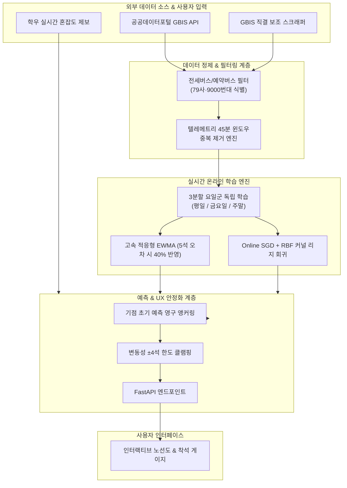
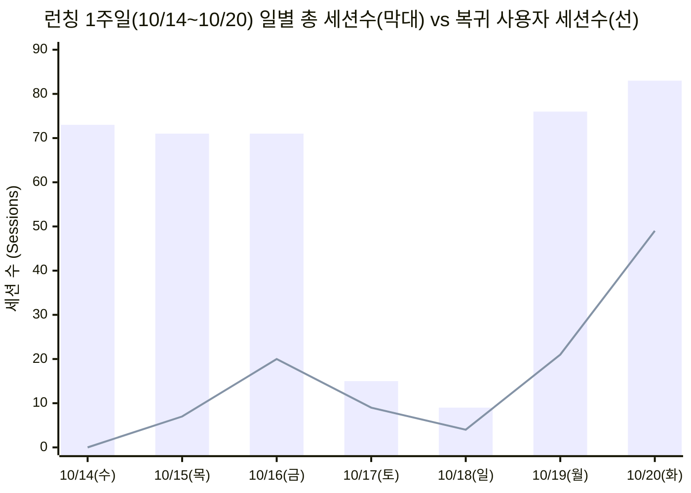

# 7790 줄 서요? - 광역버스 실시간 좌석 예측 & MLOps 시스템

> **"내가 지금 줄을 서면 앉아갈 수 있을까?"**  
> 수원대학교 ↔ 사당역 7790번 광역버스의 불확실한 잔여 좌석을 실시간 온라인 머신러닝(Online SGD + Empirical Bayes)과 도메인 특화 데이터 파이프라인으로 정밀 예측하는 서비스입니다.

[](https://www.python.org/)
[](https://fastapi.tiangolo.com/)
[](https://scikit-learn.org/)
[]()

---
서비스 링크: https://bus-project-e9nd.onrender.com/

## 1. Project Overview (프로젝트 개요)

- **문제 정의**: 
  - 7790번 광역버스는 출퇴근·통학 시간대 입석 금지와 극심한 수요 집중으로 인해, 정류장 도착 직전에 잔여 좌석이 0석으로 급감하여 승차 거부되는 문제라는 pain_point 발견
  - 기존 포털 지도 앱은 __'현재 버스에 남은 좌석' 만 보여줄 뿐,__ __'버스가 내 정류장에 도착했을 때 남을 좌석'__ 을 미리 알려주지 못해 사용자가 줄을 설지 말지 판단할 수 없음.
- **해결 솔루션**:
  - 기점(협성대·봉담)에서 버스가 출발하는 순간, 선행 정류장(효행초·아이파크·신명)의 시간대별 연쇄 승차 패턴을 추론하여 **내 정류장 도착 시 최종 잔여석을 사전에 예측**.
  - 사당역 하행 회차 대기열 및 실시간 시민 제보 데이터를 결합하여 회차 빈 차 착석 가능성 산출.
  - 실제 배포 후 발생한 데이터 노이즈(전세버스 혼입, 1층/2층 버스 편차, 예측 플래핑)를 실시간 텔레메트리 기반으로 지속 개선한 프로덕션 엔지니어링 프로젝트.

---

## 2. System Architecture (시스템 구조)



---

## 3. Key Engineering Challenges & Solutions (핵심 문제 해결)

### Issue 1. [UX vs ML] "중간에 예측값이 자꾸 바뀌면 줄을 설 수가 없다"
- **현상**:
  - 버스가 효행초, 아이파크를 지나며 실제 승객이 탈 때마다 버스 좌석 잔여석이 줄어들고, 중간 감산 로직이 실시간 재계산되면서 수원대 도착 예측 좌석이 `40석 → 35석 → 28석`으로 계단식으로 떨어지는 **예측 플래핑(Drift/Flapping)** 발생.
  - 학생이 기점 출발 시 "40석 남는다"는 예측을 믿고 줄을 서러 나갔는데, 걸어가는 동안 숫자가 깎여 의사결정의 신뢰가 무너짐.
- **원인 분석**:
  - 모델의 수학적 정확도(실시간 데이터 반영)와 사용자의 심리적 의사결정 타임라인(기점 출발 시점 1회 결정) 사이의 괴리.
- **엔지니어링 솔루션**:
  - **기점 초기 예측값 영구 앵커링(Lock-in)**: 버스가 기점에서 출발할 때의 예측값을 불변의 기준점으로 메모리에 잠금.
  - **변동성 3~5석(4석) 한도 미세 조절(Damping)**: 버스가 이동하며 실시간 편차가 발생하더라도 초기 예측 기준 4석 이내에서만 완만하게 반응하도록 클램핑(Clamping) 알고리즘 적용.
- **결과**: 사용자의 "줄 서기 결심"을 끝까지 안정적으로 지켜주면서도 실시간 변동성을 흡수하는 최적의 UX 달성.

---

### Issue 2. [Data Noise] 통학 불가 '외부 전세버스'의 일반 버스 오인 사태
- **현상**:
  - GBIS API 상에서 통학 학생이 탈 수 없는 출퇴근 임차 전세버스가 일반 7790번과 동일한 노선 ID로 섞여 들어와, 사용자에게 빈 차로 도착할 것처럼 잘못 안내되는 문제 발생.
- **원인 분석**:
  - 정규 노선버스 면허(경기 70사 수원 / 경기 76아 화성)와 외부 전세버스 면허(경기 79사, 78사 등)의 메타데이터 혼재.
- **엔지니어링 솔루션**:
  - **다단계 차량 면허 식별 필터** 구현:
    1. 차량 번호판 대역 정규식 분석 (`경기79`, `79사`, `9000번대` 임차 번호 식별)
    2. API 예약 플래그 및 배차 시간대 매칭
    3. 백엔드 도착 목록, 노선도 마커, MLOps 학습 파이프라인 전역에서 원천 차단.
- **결과**: 일반 학생이 탈 수 있는 순수 정규 차량만 100% 필터링되어 대기 혼선 원천 방지.

---

### Issue 3. [MLOps] 배치(Batch) 학습의 한계와 실시간 3분할 온라인 학습
- **현상**:
  - 주말마다 모델을 재학습하는 전통적 배치 방식으로는 **비 오는 날, 축제/시험 기간, 금요일 심야 귀가 대란** 등의 급격한 패턴 변화를 즉시 따라가지 못함.
- **엔지니어링 솔루션**:
  - **Online Incremental SGD + Empirical Bayes 하이브리드** 구축:
    - 버스가 정류장을 통과할 때마다 실시간 텔레메트리를 수집하여 즉시 파라미터 업데이트.
    - **적응형 학습률**: 예측 오차가 5석 이상 벌어지면 $\alpha = 0.40$(40% 고속 적응), 5석 미만일 때는 $\alpha = 0.25$(안정 반영).
    - **3분할 요일군 모델 분리**: `평일(월~목)` 정규 통학 / `금요일` 귀향 및 모임 / `주말·공휴일` 감차 운행을 각각 독립된 가중치와 버킷으로 분리 학습.
- **결과**: 외부 이벤트 발생 시 다음 버스 1~2대 만에 오차를 스스로 교정하는 자체 치유(Self-healing) 모델 구현.

---

### Issue 4. [Model Validation] 1층 버스(45/49석) vs 2층 버스(71석) 이종 차종 분리 및 실측 검증
- **검증 결과 (2026-10-21 수요일 21회 운행 전수 실측 대조)**:
  - 출근 극피크(06:48)에 투입된 **1층 49석 버스(`1265`)**:
    - 기점 출발 당시 예측치: 효행초 32석 / 아이파크 19석 / 신명 17석 / **수원대 16석**
    - 실제 정류장 도착 실측치: 효행초 34석 / 아이파크 20석 / 신명 17석 / **수원대 16석**
    - **신명아파트와 수원대입구에서 기점 예측치 오차 0석(100% 적중)** 기록.
  - 상행 4개 정류장 평균 절대 오차(MAE): **$\pm$3.2 ~ 4.4석** 달성.


---

## 🛠️ 4. Tech Stack (기술 스택)

- **Backend**: Python 3.11, FastAPI, Uvicorn, Requests
- **Machine Learning**: Scikit-Learn (Ridge), NumPy, Online SGD, Empirical Bayes, RBF Kernels
- **Data Engineering**: Real-time GBIS Telemetry Pipeline, CSV Stream Logger, Atomic File Persistence
- **Frontend**: Vanilla JavaScript (ES6+), Tailwind CSS, Responsive SVG Map Engine

---

## 📂 5. Project Directory Structure

```text
bus_project/
├── core/
│   └── config.py               # 정류장 XAI 프로필, 노선 메타데이터, 학사일정 판별
├── data/
│   ├── sadang_telemetry.csv    # 사당역 하행 실측 탑승 데이터셋
│   └── upstream_telemetry.csv  # 상행 4개 정류장 연쇄 승차 텔레메트리
├── models/
│   └── sadang_online_model.json # 3분할 요일군 모델 파라미터 및 EWMA 버킷
├── services/
│   ├── gbis_client.py          # 공공데이터 API 및 전세버스/차종 판별
│   ├── online_learner.py       # 실시간 온라인 MLOps 엔진 (SGD + Bayes)
│   ├── prediction_engine.py    # 기점 앵커링 & ±4석 댐핑 예측 엔진
│   ├── telemetry_logger.py     # 원자적 텔레메트리 스트림 로거
│   └── crowd_service.py        # 학우 집단지성 실시간 제보 처리기
├── static/
│   ├── js/app.js               # 실시간 UI 렌더링 & 노선도 SVG 바인딩
│   └── css/style.css           # 커스텀 테마 스타일
├── main.py                     # FastAPI 앱 및 백그라운드 스케줄러
└── README.md
```

---

## 6. What I Learned (엔지니어링 회고)

1. **"ML 모델의 수치적 최적화"보다 중요한 것은 "사용자의 의사결정 맥락"**:
   - 실시간 데이터를 기계적으로 반영하는 것이 항상 최선의 UX가 아님을 배웠습니다. 사용자가 버스를 타러 갈지 결정하는 타임라인을 이해하고, 기점 예측 앵커링과 댐핑 클램프를 통해 '신뢰할 수 있는 예측'을 설계하는 경험을 쌓았습니다.
2. **도메인 지식이 결합된 데이터 엔지니어링의 힘**:
   - 광역버스 API의 단순 수치만으로는 전세버스인지, 1층 버스인지 구분할 수 없었습니다. 면허 체계와 차량 등록 번호 규칙을 파악하여 데이터 수집단에서 필터링함으로써 모델의 쓰레기 데이터(Garbage-in) 유입을 원천 차단했습니다.
3. **무중단 운영 환경에서의 MLOps**:
   - 복잡한 대형 모델 대신 가볍고 빠른 Online SGD와 Bayesian EWMA를 결합하여, 서버 재시작 없이도 실시간 데이터로 스스로 진화하는 안정적인 서비스 파이프라인을 구축했습니다.


# 7790 줄 서요? - 런칭 1주일(10/14~10/20) 실사용자 트래픽 & 행동 분석 리포트

> **분석 도구**: Microsoft Clarity (개발자 테스트 세션 `yw5782` 및 봇 트래픽 제외 순수 사용자 실측치)  
> **조사 기간**: 2026-10-14(수) 서비스 런칭 ~ 2026-10-20(화)  
> **핵심 성과 요약**: 
> 1. **누적 478 세션 / 누적 294명 고유 사용자** 달성 및 10/20 **역대 일일 최고 83세션** 돌파.
> 2. **복귀 사용자(재방문) 세션 평균 59.0%(49건) 달성**: 런칭 1주일 만에 신규 유입보다 '재방문 단골 세션'이 압도적 우위 점유.
> 3. **PWA(홈 화면 바로가기) 네이티브 앱 전환율 약 10%**: 10/19(10건) → 10/20(18건)으로 앱스토어 설치 없이 홈 화면 단독 실행 안착.
> 4. **XAI(설명 가능 AI) 탭 실사용 15건 & 2분 이상 집중 체류 13건**: 단순 좌석수 조회를 넘어 AI 예측 근거와 노선도를 능동적으로 탐색.

---

## 1. 일별 총 세션수 & 복귀 사용자 세션수 추이



---

## 2. 일자별 정밀 사용자 행동 지표 전수 대조표

| 일자 | 요일/특성 | 총 세션수 | 고유 사용자 | 신규 세션비율 | 복귀 세션비율 (리텐션) | PWA 단독 실행 | 소요된 활성 시간 | 평균 스크롤 깊이 | 분노 클릭 (Rage) |
| :---: | :---: | :---: | :---: | :---: | :---: | :---: | :---: | :---: | :---: |
| **10/14** | 수 (런칭 D-Day) | **73** | **63명** | 100% (73건) | 0.0% (0건) | - | **33초** | **92.85%** | **0%** |
| **10/15** | 목 (D+1) | **71** | **59명** | 90.1% (64건) | **9.9% (7건)** | - | **57초** | **93.58%** | **0%** |
| **10/16** | 금 (D+2) | **71** | **58명** | 71.8% (51건) | **28.2% (20건)** | - | **1.9분 (114초)** | **92.60%** | **0%** |
| **10/17** | 토 (D+3) | **15** | **10명** | 40.0% (6건) | **60.0% (9건)** | - | **2.8분 (168초)** | **96.86%** | **0%** |
| **10/18** | 일 (D+4) | **9** | **9명** | 55.6% (5건) | **44.4% (4건)** | - | **16초** | **99.90%** | **0%** |
| **10/19** | 월 (D+5) | **76** | **62명** | 72.4% (55건) | **27.6% (21건)** | **10건** (13.2%) | **59초** (총 4.5분) | **87.49%** | **0%** |
| **10/20** | 화 (D+6) | **83** | **53명** | 41.0% (34건) | **59.0% (49건)** | **18건** (21.7%) | **41초** (총 2.2분) | **81.35%** | **0%** |
| **누적 / 평균** | **런칭 7일간** | **총 478 세션** | **누적 294명** | **평균 67.3%** | **최대 60% 단골 점유** | **평균 9건** | **체류시간 5배↑ 안정화** | **평균 92.1%** | **0.0%** |

---

---


